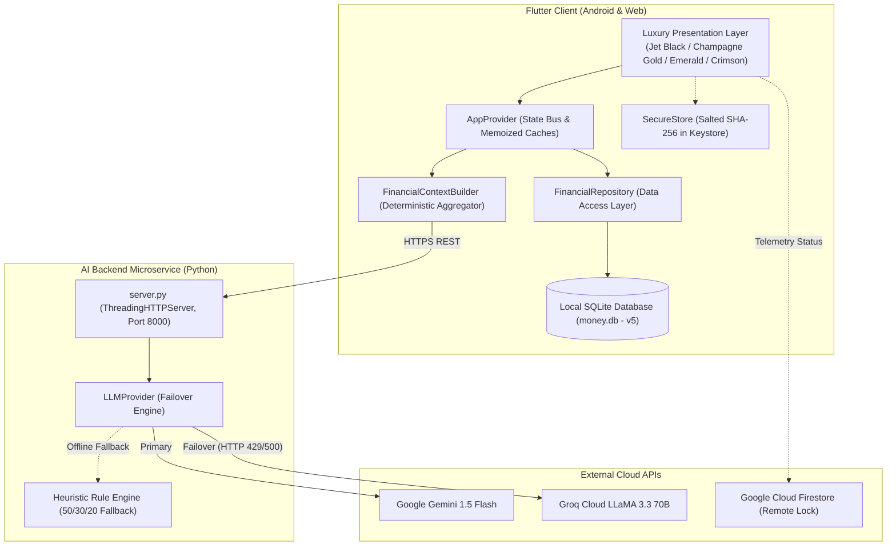

# MONEY — AI-Powered Personal Finance Coach

[](https://flutter.dev)
[]()
[]()
[]()
[]()
[]()

> **Smart FinTech Hackathon Project**: An ultra-premium personal finance ecosystem combining an offline-first SQLite core with dual-model conversational intelligence powered by **Google Gemini** and **Groq Cloud**.

---

## 1. Overview

**MONEY** transforms personal financial management from a passive recording chore into an active, private-banking advisory experience. Built for young earners, salaried professionals, students, and gig economy workers, MONEY couples deterministic mathematical ledgers with proactive, context-aware AI coaching.

The application follows an **offline-first philosophy**: all financial transactions, account ledgers, budgets, and savings goals remain private on the user's device in an indexed SQLite database. When guidance is requested, aggregated financial context is prepared on-device and analyzed via a quarantined AI microservice, ensuring that financial figures are verified deterministically before interpretation by the LLM.

---

## 2. Problem Statement

Young professionals and students frequently face financial stress, debt accumulation, and uncontrolled discretionary burn. Traditional personal finance applications present several critical friction points:

1. **Passive "Post-Mortem" Tracking**: Most apps record expenses without providing proactive guidance on how to rebalance outflows before the month ends.
2. **Privacy Concerns & Ad Tracking**: Many cloud-based finance apps sell aggregated consumer transaction data to advertisers and loan providers.
3. **AI Hallucinations in Financial Calculations**: Generic chatbots invent mathematical figures when asked to calculate balances or budget allocations.
4. **Uninspiring Interface Aesthetics**: Generic SaaS designs make daily budgeting feel punitive rather than empowering.

MONEY addresses these challenges with **offline-first data ownership**, a **luxury private-banking aesthetic**, and an **AI architecture where math is solved deterministically while advice is formulated by the LLM**.

---

## 3. Features

### ✅ Implemented & Verified Capabilities

- **Ultra-Premium Luxury FinTech Interface**: Adheres to the official private-banking palette (Jet Black `#000000`, Charcoal Grey `#1C1C24`, Forest Green `#0B2E20`, Emerald Green `#0F6B4F`, Champagne Gold `#D4AF37`, Deep Crimson `#8B0000`).
- **Dominant Financial Balance**: Real-time monthly net cash flow with an instantaneous toggle to all-time wealth accumulation.
- **Dynamic Burn Indicators**: Real-time calculation of savings percentage, transaction count, and daily average burn rate.
- **AI Financial Coach (Gemini & Groq)**: Natural-language advisory analyzing spending patterns, top outflows, and discretionary leaks with automatic failover.
- **AI Monthly Budget Planner**: Zero-based budget generator using the 50/30/20 framework with feasibility checks, shortfall detection, and real-time interactive rebalancing.
- **13 Specialized Navigation Hubs**: Home, AI Coach, AI Planner, Transactions, Analytics, Categories, Expenses, Debts, Budgets, Accounts, Limits, Data Export, and Settings.
- **Interactive Analytics**: Touch-interactive pie charts, category breakdowns, and 6-month historical outflow trends (`fl_chart`).
- **Multi-Account & Debt Ledgers**: Track balances across Cash, Bank, UPI, and Credit Cards, alongside borrower/lender debt obligations.
- **Statement & Data Export**: Generates print-ready PDF statements and CSV ledgers for accounting and tax preparation.
- **Hardware-Backed PIN Security**: Salted SHA-256 PIN hashing with per-device 32-byte salts stored in Android `EncryptedSharedPreferences` / iOS Keychain.
- **Cloud Remote Kill-Switch**: Remote device lockout telemetry via Cloud Firestore to protect financial data on lost or compromised devices.

### 🔮 Planned Future Enhancements

- RBI-regulated Account Aggregator (AA) direct bank feed integration.
- Live Forex multi-currency automated conversion.
- On-device quantized Small Language Model (Gemma 2B) for 100% offline edge inference.

---

## 4. Technology Stack

| Layer | Technology | Details |
| :--- | :--- | :--- |
| **Frontend Framework** | **Flutter 3.24.5** / **Dart 3.5.4** | Multi-platform client targeting Android & Web |
| **State Management** | **Provider 6.1.1** | Reactive change notification with memoized caching |
| **Local Database** | **SQLite (`sqflite: ^2.3.2`)** | Embedded relational database with schema migration engine (v1–v5) |
| **Secure Storage** | **`flutter_secure_storage: ^9.2.4`** | Hardware keystore/keychain encrypted storage |
| **Biometrics & Crypto** | **`local_auth: ^2.1.8`, `crypto: ^3.0.3`** | Hardware biometric unlock & salted SHA-256 hashing |
| **Charts & Visuals** | **`fl_chart: ^0.68.0`** | Interactive vector charts with custom touch tooltips |
| **Reporting** | **`pdf: ^3.10.8`, `csv: ^6.0.0`** | Native vector PDF rendering and tabular CSV export |
| **AI Microservice** | **Python 3.10+ (`http.server`)** | Stateless REST microservice with rate limiting & CORS |
| **Primary LLM** | **Google Gemini 1.5 Flash** | High-speed, structured JSON financial guidance |
| **Failover LLM** | **Groq Cloud LLaMA 3.3 70B** | Hardware-accelerated sub-500ms backup inference |

---

## 5. System Architecture



---

## 6. Project Structure

```text
My-Money/
├── android/                      # Native Android configuration (Kotlin DSL, MinSDK 21)
├── assets/                       # Image assets and application iconography
├── lib/
│   ├── database/                 # SQLite helper (db_helper.dart) & v1->v5 migration engine
│   ├── models/                   # Immutable models (Expense, Income, AiBudgetPlan, Debt, Account)
│   ├── providers/                # AppProvider state bus & analytical caching
│   ├── repositories/             # FinancialRepository data-access layer
│   ├── screens/                  # 13 application hubs:
│   │   ├── dashboard_screen.dart # Ultra-luxury financial dashboard
│   │   ├── ai_coach/             # Conversational financial coach & portfolio insights
│   │   ├── ai_budget/            # AI Monthly Budget Planner & interactive allocator
│   │   ├── transactions/         # Transaction ledger & recurring sheet
│   │   ├── analytics/            # Spending breakdown & interactive fl_chart graphs
│   │   └── ...                   # Categories, Debts, Budgets, Accounts, Limits, Settings
│   ├── services/                 # AI REST client, context builder, Firebase remote lock
│   ├── utils/                    # Centralized luxury theme (theme.dart), constants, crypto utils
│   └── widgets/                  # Reusable luxury widgets, empty states, budget bars
├── test/                         # 29 automated unit, widget, and state-machine tests
└── web/                          # Production Web runner, index.html & manifest

server/                           # Python AI Backend Microservice
├── server.py                     # High-concurrency ThreadingHTTPServer with CORS & rate-limiting
├── llm_provider.py               # Gemini 1.5 Flash + Groq LLaMA 3.3 70B failover & rule engine
├── requirements.txt              # Zero heavy dependencies
├── .env.example                  # Safe configuration template
└── run_server.bat                # One-click startup script for Windows

releases/                         # Verified installable binaries
├── MONEY-v2.0.0-release.apk      # Directly installable Android APK (30.76 MB)
└── MONEY-v2.0.0-release.aab      # Google Play Store App Bundle (30.46 MB)

docs/                             # In-depth technical documentation for Jury review
├── TECH_STACK_AND_ARCHITECTURE.md
├── FEATURES_AND_DATA_FLOW.md
├── DEVELOPMENT_AND_RELEASE.md
└── JURY_PREPARATION.md
```

---

## 7. Prerequisites

- **Flutter SDK**: `3.24.5` (Channel stable)
- **Dart SDK**: `3.5.4`
- **Python**: `3.10+`
- **Android SDK**: `API Level 34+` (JDK 17)
- **Google Chrome**: For running the web application

---

## 8. Installation

### 1. Clone & Set Up Flutter Client
```bash
git clone https://github.com/thekrishnasarathe/My-Money.git
cd My-Money/My-Money
flutter pub get
```

### 2. Set Up Python AI Backend
```bash
cd ../server
pip install -r requirements.txt
```

---

## 9. Environment Configuration

Copy the example environment file inside `server/`:
```bash
cp server/.env.example server/.env
```

Edit `server/.env` with your preferred AI provider keys:
```env
AI_PROVIDER=gemini
GEMINI_API_KEY=your_gemini_api_key_here
GROQ_API_KEY=your_groq_api_key_here
GEMINI_MODEL=gemini-1.5-flash
GROQ_MODEL=llama-3.3-70b-versatile
PORT=8000
HOST=0.0.0.0
```

> **Zero-Key Resilient Fallback**: If external API keys are omitted, the server automatically switches to its internal deterministic heuristic engine—no crash or empty responses will ever be served.

---

## 10. Running Locally

### Step 1: Start the AI Backend
```bash
cd server
python server.py
# Server starts on http://localhost:8000
```

### Step 2: Launch the Frontend

#### Running on Web (Google Chrome):
```bash
cd My-Money
flutter run -d chrome
```

#### Running on Android:
```bash
cd My-Money
flutter run -d android
```

---

## 11. Production Builds & Distribution Deliverables

### A. Android Release APK (Directly Installable)
```bash
cd My-Money
flutter build apk --release
```
- **Generated File**: `My-Money/build/app/outputs/flutter-apk/app-release.apk`
- **Release Location**: [`releases/MONEY-v2.0.0-release.apk`](file:///c:/Users/krish/Desktop/My-Money/releases/MONEY-v2.0.0-release.apk)
- **File Size**: `32,257,619 bytes` (30.76 MB)
- **SHA-256 Checksum**: `9BB5589AF04C053B9BCBD6625D09A383C662F853AADE23CC9AAE0BA4699E2AED`

### B. Android App Bundle (Google Play Distribution)
```bash
cd My-Money
flutter build appbundle --release
```
- **Generated File**: `My-Money/build/app/outputs/bundle/release/app-release.aab`
- **Release Location**: [`releases/MONEY-v2.0.0-release.aab`](file:///c:/Users/krish/Desktop/My-Money/releases/MONEY-v2.0.0-release.aab)
- **File Size**: `31,939,712 bytes` (30.46 MB)
- **SHA-256 Checksum**: `AB628D64AEEF3D20CC49B7CD9840D46D7C439B666FF0A78BC024AB97FA1A136B`

### C. Web Production Build (Static Bundle)
```bash
cd My-Money
flutter build web --release
```
- **Generated Directory**: `My-Money/build/web/`
- **Serve Locally via Python**:
  ```bash
  python -m http.server 8080 --directory My-Money/build/web
  ```

---

## 12. Verification & Test Suite

The project includes 29 automated tests spanning unit logic, budget math, context builders, and widget rendering:

```bash
cd My-Money
flutter test
```

### Verified Test Matrix:
- **`ai_budget_planner_test.dart`** (15 tests):
  - Form validation, negative income checks, shortfall/deficit handling.
  - Feasibility math normalization: $\sum \text{Allocations} = \text{Income}$.
  - Dynamic interactive editing, category deduplication, and budget rebalancing.
  - JSON serialization, SQLite persistence, and multi-user isolation.
- **`ai_integration_test.dart`** (8 tests):
  - Gemini & Groq model parsing, failover recovery, offline analytical fallback.
  - Safe metric extraction in `FinancialContextBuilder`.
- **`remote_lock_cache_test.dart`** (3 tests):
  - Offline fail-safe state machine, cached status enforcement, zero-lockout first launch.
- **`widget_test.dart`** (3 tests):
  - `DashboardScreen` luxury elements (numerals, cards, empty states, FAB).
  - `AiCoachScreen` tabs and quick prompt chips.
  - `HomeScreen` 13-destination scrollable navigation.

```text
00:06 +29: All tests passed!
```

---

## 13. Security Architecture

1. **Secret Isolation**: Client builds contain zero API keys. All LLM credentials reside exclusively in server environment variables.
2. **Salted SHA-256 PIN Protection**: Per-device 32-byte salt generated using `Random.secure()` stored in hardware-backed secure storage.
3. **Data Privacy**: Transactions remain in local SQLite (`money.db`). No financial records are stored on cloud servers.
4. **Cloud Remote Lock**: Real-time device lockout telemetry via Cloud Firestore allows users to remotely lock compromised devices.

---

## 14. Known Limitations

- **Currency Denomination**: Native amounts use Indian Rupees (`₹`). Multi-currency conversion is planned.
- **Direct Banking APIs**: Transactions are currently recorded manually or imported via CSV (Account Aggregator integration planned).
- **Web Keystore**: On web builds, `flutter_secure_storage` uses Web Cryptography API / IndexedDB; on Android, it uses hardware-backed Keystore.

---

## 15. Hackathon Jury Demonstration Flow

1. **Dashboard & Luxury Presentation**: Show the Champagne Gold dominant balance, Emerald income card, Deep Crimson expense card, and secondary daily burn chips.
2. **Transaction Addition**: Tap the Champagne Gold FAB to record an expense. Notice the instantaneous recalculation of net balance.
3. **AI Financial Coach**: Tap "Ask Coach" to demonstrate context-aware financial advice comparing income vs. discretionary spending.
4. **AI Monthly Budget Planner**: Open the Planner, enter monthly income and fixed commitments, and generate a zero-based budget. Demonstrate real-time rebalancing and apply it to the budget tracker.
5. **Analytics & Charts**: View the interactive category pie chart and six-month historical trend.
6. **Codebase & Architecture**: Walk the jury through [`docs/TECH_STACK_AND_ARCHITECTURE.md`](docs/TECH_STACK_AND_ARCHITECTURE.md) and [`docs/JURY_PREPARATION.md`](docs/JURY_PREPARATION.md).
7. **Deliverable Verification**: Present the verified Android APK (`releases/MONEY-v2.0.0-release.apk`) and running web application.

---

## 16. License & Attribution

- **Product Name**: MONEY / My-Money
- **Lead Architect & Engineer**: **Krishna Sarathe** ([thekrishnasarathe000@gmail.com](mailto:thekrishnasarathe000@gmail.com))
- **Copyright**: `© 2026 Krishna Sarathe. All rights reserved.`
- **License**: MIT License. See [LICENSE](LICENSE) for details.
